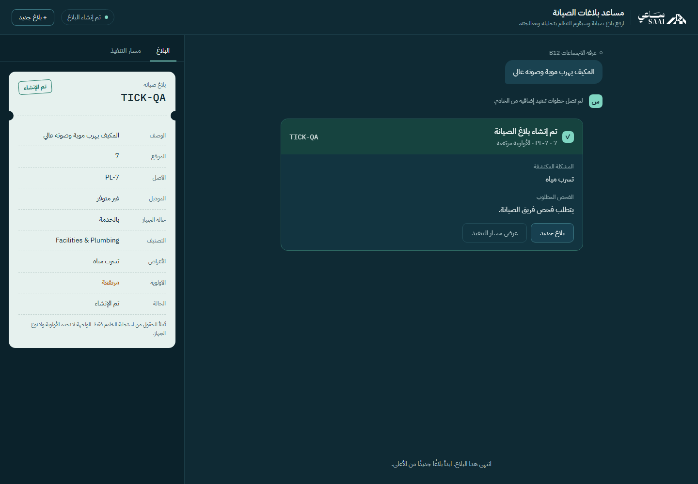
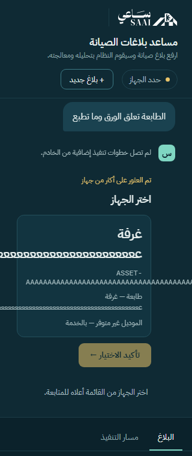

# تدقيق QA لمساعد الصيانة — 13 أكتوبر 2026

هذا سجل نتائج الاكتشاف قبل المعالجة. التنفيذ والتحقق بعد الإصلاح موثقان في `QA_REPAIRS.md`. أُدخلت حالات إعادة الإنتاج في الاختبارات الدائمة؛ اسم ملف الخلفية الحالي `tests/qa/test_adversarial_cases.py`.

اختُبرت النسخة الحالية في مساحة العمل، بما فيها الإصلاحات غير المرفوعة إلى GitHub. لم يُغيَّر كود التطبيق أثناء هذا التدقيق؛ أُضيفت أدوات إعادة إنتاج وأدلة وتقرير. استُخدمت قواعد بيانات وcheckpoints وفهارس مؤقتة. استُعير النموذج المحلي الشغّال للاستدلال فقط، وقرئت أوزان embeddings المحلية دون تعديلها.

## النتائج

| مجموعة التحقق | ناجح | كشف توقعًا غير محقق | بيئة الإثبات |
|---|---:|---:|---|
| اختبارات الخلفية الأساسية | 119 | 0 | استخراج heuristic ومتجهات مضبوطة، مع SQLite حقيقية مؤقتة |
| اختبارات المتصفح الأساسية | 29 | 0 | Chromium وAPI فعلية مع استخراج مضبوط |
| الحالات الاستكشافية للخلفية | 13 | 9 | API وSQLite فعلية مؤقتة؛ حقن توقيت تغيير الجهاز معلن |
| الحالات الاستكشافية للواجهة | 4 | 5 | Chromium؛ بعض الردود fixtures معلنة لاختبار العقد |
| استخراج ASL العصبي الحقيقي | 7 | 0 | خدمة llama.cpp المحلية، temperature=0، دون إنشاء تذاكر |
| سير العمل بالنموذج والبحث الحقيقيين | 5 | 0 | كود API الحالي، ASL حقيقي، embeddings حقيقية، وفهرس وقاعدة مؤقتان |

الحالات الاستكشافية الإضافية عددها **43**: نجح منها **29**، وكشفت **14 حالة** توقعات غير محققة، جُمعت في **8 ملاحظات** أدناه. عدد الحالات الفاشلة لا يساوي عدد العيوب، وبعضها يمثل فجوة في المتطلبات أو دفاعًا أمام رد مصطنع، وليس عطلًا حدث مع النموذج الحقيقي.

بناء الواجهة ناجح. النتائج التفصيلية ومخرجات إعادة الإنتاج في `docs/qa/observations.json`؛ توجد أيضًا ملفات XML وJSON والتتبعات في مجلدات تقارير الاختبارات المحلية.

## الملاحظات حسب الأولوية

### QA-01 — P1: تحذير غير مصعّد موجود في الرد ويختفي من الواجهة

**الإثبات:** في اختبار API بمخرجات استخراج مضبوطة، جهاز سباكة مسجل مع `water_leak` و`flooding` ينتج `status=success` و`priority=high` وتحذير سلامة محفوظًا في التذكرة. اختبار المتصفح برد مطابق لهذا الشكل يعرض بطاقة النجاح دون التحذير. `SuccessResult` لا يقرأ `safety_message` رغم سماح العقد به.

**الأثر:** المستخدم قد لا يرى التحذير الذي أصدرته السياسة، لأن عرض التحذير مرتبط بمكوّن الحالة الحرجة.

**الموضع:** `frontend/src/components/results/SuccessResult.tsx:6`.

**إعادة الإنتاج:** حالة الخلفية `test_noncritical_flood_warning_is_present_in_real_api_output` وحالة المتصفح `a noncritical API safety warning remains visible on a success card`.

**الإصلاح المقترح:** عرض أي `safety_message` موجود في كل نتيجة مناسبة، بما فيها النجاح، مع الحفاظ على تصنيف الأولوية المعتمد. قبول الإصلاح: النص في API والتذكرة والبطاقة متطابق.



### QA-02 — P1: نقل الجهاز بعد المطابقة وقبل الحفظ يسمح بتذكرة بموقع قديم

**الإثبات:** بعد مطابقة `AC-B12-02`، ينقل الاختبار سجله إلى الغرفة `999` قبل تنفيذ `insert_ticket` مباشرة. يرجع API نجاحًا وتذكرة واحدة، مع موقع `B12` في رد الجهاز، بينما السجل الحالي يشير إلى `999`. تحقق الحفظ يراجع النوع والحالة، دون الموقع. اختبار تغيّر الحالة إلى inactive، أو النوع، أو حذف الجهاز في التوقيت نفسه يمنع إنشاء التذكرة بنجاح.

**الأثر:** التذكرة الجديدة أو بيانات الأصل المعروضة قد توجه المعالجة إلى موقع لم يعد موقع الجهاز الحالي. الاختبار يفرض نافذة التزامن ولا يدعي أن الجهاز نُقل فعلًا في بيانات المستخدم.

**الموضع:** `backend/app/db/database.py:178`.

**إعادة الإنتاج:** `test_asset_is_still_valid_at_ticket_commit[moved]`.

**الإصلاح المقترح:** اعتماد قرار واضح عند تغير بيانات الأصل أثناء المعالجة: إعادة المطابقة، أو رفض النتيجة القديمة، أو تحديث موقع الأصل المعروض مع حفظ موقع البلاغ التاريخي مستقلًا. تطبيق التحقق داخل معاملة الحفظ أو باستخدام إصدار للسجل؛ إعادة القراءة قبل المعاملة وحدها لا تغلق نافذة التزامن.

### QA-03 — P1: الإجابة القديمة تُستهلك بعد انتقال السؤال

**الإثبات:** يبدأ بلاغ «جهاز فيه مشكلة»، فيطلب النوع. إرسال «المكيف» ينقل المسار إلى سؤال الموقع. إعادة إرسال جسم الإجابة السابق يرجع HTTP 200 ويضيف «المكيف» مرة ثانية إلى `follow_up_answers` بدل رفض الاستكمال المستهلك. الرد القديم لا يحمل معرّف الخطوة أو interrupt الذي يخصه.

**الأثر:** طلب متأخر من تبويب آخر أو إعادة إرسال شبكية يمكن أن يدخل إجابة سؤال سابق في الخطوة الجديدة. لم يُنشئ هذا الاختبار تذكرتين؛ حماية إنشاء التذاكر ما زالت ناجحة.

**المواضع:** `backend/app/schemas.py:107` و`backend/app/main.py:168`.

**إعادة الإنتاج:** `test_replaying_old_answer_does_not_consume_a_new_question`؛ مخرجات التشغيل المحدّث في `backend/data/reports/qa-replay.xml`.

**الإصلاح المقترح:** إرجاع `step_id` مع السؤال، وإرساله مع الاستكمال والتحقق منه تحت القفل. لا تحذف الإجابات بناءً على تطابق نصها؛ قد يجيب المستخدم بالنص نفسه عمدًا في خطوتين مختلفتين.

### QA-04 — P2: API لا يفرض حدود النصوص التي تفرضها الواجهة

**الإثبات:** وصف فارغ، ووصف من فراغات، ووصف بطول 4008 محارف قُبلت بـHTTP 200. إجابة من فراغات وإجابة بطول 2005 محارف قُبلتا أيضًا. الوصف الطويل والإجابة الطويلة أنتجا تذكرة في بيئة heuristic المعزولة. حقلا schema من نوع `str` دون حدود أو تحقق بعد إزالة الفراغات، بينما الواجهة تضع 4000 و2000.

**الأثر:** عميل مباشر يتجاوز القيود المرئية ويرسل نصًا لا يمثل بلاغًا أو يتجاوز ميزانية الإدخال المقصودة. هذا تحقق من عدم اتساق الحدود، ولم يُجرَ اختبار استنزاف موارد على النموذج الحقيقي.

**الموضع:** `backend/app/schemas.py:101` و`:107`.

**الإصلاح المقترح:** تحديد الحد الأدنى والحد الأقصى في API والتحقق من النص بعد trim، وإرجاع 422 قبل تشغيل المسار، مع مطابقة الحدود في الواجهة.

### QA-05 — P2، دفاع أمام ردود مصطنعة: التحقق في الواجهة يقبل تناقضات دلالية

**الإثبات:** fixture يحمل `status=success` مع تذكرة `escalated` وأولوية `critical` يُقبل ويعرض نجاحًا. fixture آخر يحمل `status=critical` وتحذيرًا فارغًا يُقبل أيضًا. لم ينتج API الحالي هذه الردود في الاختبارات الحقيقية؛ هذه فحوص دفاعية لعقد الشبكة.

**الموضع:** `frontend/src/services/responseSchema.ts:34`.

**الإصلاح المقترح:** ربط حالة النتيجة بحالة التذكرة والأولوية، واشتراط نص غير فارغ للتحذير في الحالات الحرجة. يجب رفض الرد المتناقض قبل عرضه.

### QA-06 — P2، فجوة استعادة في تجربة الاستخدام: تحديث الصفحة يفقد الاستكمال

**الإثبات:** تظهر شاشة سؤال الاستكمال، ثم بعد reload تعود الواجهة إلى البداية وتختفي خانة الإجابة. `threadId` والرسائل في ذاكرة React. حفظ checkpoint في الخلفية يستمر، لكن الواجهة لا تحتفظ بمعرّف لاسترجاعه.

**الموضع:** `frontend/src/App.tsx:16`.

**القرار المطلوب في تصميم المنتج:** تحديد دعم استئناف البلاغ بعد reload. إذا كان مطلوبًا، احتفظ بمعرّف مناسب للجلسة وأضف قراءة آمنة للحالة من API، ثم اختبر العودة إلى السؤال نفسه والتعامل مع محادثة اكتملت من تبويب آخر. هذه قدرة غير مكتملة؛ لا يوجد في الاختبار دليل على ضياع checkpoint نفسه.

### QA-07 — P2، حالة قصوى: بيانات جهاز طويلة تُقص على الجوال

**الإثبات:** عند عرض 320px وباستخدام metadata مصطنعة يجيزها العقد الحالي، عرض البطاقة الداخلي 222px بينما محتواها يحتاج 12890px. تظهر سلاسل الموقع والمعرف خارج البطاقة ثم تُقص داخل منطقة المحادثة. لا يُدعى وجود هذا الطول في بيانات seed العادية أو وجود overflow أفقي على كامل الصفحة.

**الموضع:** `frontend/src/styles.css:148`.

**الإصلاح المقترح:** إتاحة التفاف الكلمات غير المنقطعة وتقييد أحجام أبناء flex/grid، أو وضع حدود موثقة للـmetadata مع عرض كامل قابل للوصول.



### QA-08 — P2، وضع التجربة فقط: heuristic لا يتعامل مع تعدد المخاطر والنفي

**الإثبات:** «المكيف يهرب موية على اللوحة الكهربائية وفيه دخان» يستخرج `electrical_risk` فقط بسبب `elif`. «المكيف ما يبرد، ما فيه دخان ولا ريحة حريق ولا تسريب» يصعد إلى critical بسبب مطابقة الكلمات دون فهم النفي. ASL العصبي الحقيقي نجح في هاتين الحالتين ضمن العينة.

**الموضع:** `backend/app/llm/client.py:165` و`:215`.

**الإصلاح المقترح:** جعل وضع heuristic سيناريوهات عرض محددة ومعلنة، أو تحسين الاستخراج مع اختبارات النفي والجمع. يجب ألا يُستخدم نجاح القواعد مع tags محقونة كدليل على قدرة هذا المحلل على اكتشافها من النص.

## ما نجح تحت الضغط والحالات غير المعتادة

- 20 اختيارًا متنافسًا لأجهزة مختلفة في المحادثة نفسها: نجاح واحد، و19 رفضًا بـ409، وتذكرة واحدة مرتبطة بالخيار الفائز.
- 12 بلاغًا مستقلًا بالتوازي للجهاز نفسه: 12 محادثة و12 تذكرة مستقلة دون اختلاط الحالة.
- 20 نقرة تأكيد فورية في المتصفح: طلب استكمال واحد.
- فقد رد HTTP بعد حفظ التذكرة فعليًا: تظهر نتيجة غير مؤكدة دون إعادة POST تلقائيًا أو دعوة لإعادة إنشاء الطلب.
- إدخال HTML وJavaScript في النص يظهر كنص ولا ينفذ في الحالة المختبرة.
- خمسة أشكال للأرقام والمسافة في رقم الغرفة: المطابقة بقيت `PR-301-01`.
- محارف SQL في الموقع لم تعدّل جدول الأجهزة.
- payloads بأنواع JSON غير صالحة ومعرّف محادثة مفقود في رد الاستكمال رُفضت في الحدود المختبرة.

## اختبارات النموذج الحقيقي

استخراج ASL نجح في المخاطر المركبة، ونفي المخاطر، ومحاولة تغيير التعليمات داخل البلاغ، والأرقام العربية، والسخان غير الموجود في seed، وعدم ذكر عطل، ومحادثة غير متعلقة بالصيانة. استغرق الاستخراج نحو 9.23–15.73 ثانية لكل حالة في هذا التشغيل؛ لا يوجد SLA معتمد يُحكم به على هذه الأزمنة.

المسار الكامل مع embeddings حقيقية نجح في خمسة سيناريوهات: تسرب موثق بالمصدر، ومخاطر دخان وكهرباء مجتمعة بترتيب التحذير الثابت، ونفي المخاطر، وسؤال موقع ثم اختيار طابعة، ورقم غرفة عربي. طابقت التذاكر المحفوظة مع `thread_id` والجهاز والحالة والتوصية والتحذير في الردود. تراوحت أزمنة السيناريوهات بين 13.24 و28.57 ثانية؛ السيناريو الأطول يتضمن عدة استدعاءات.

هذه عينة موجهة، وليست إثباتًا عامًا لجودة النموذج أو مقاومة جميع أساليب تغيير التعليمات. لم يُختبر نشر خارجي، أو قارئ شاشة فعلي، أو جميع المتصفحات، أو سياسة صلاحيات مستخدمين متعددة.

## إعادة التشغيل

الاختبارات الاستكشافية مستقلة عن مجموعة regression الافتراضية لأن بعضها يتحقق من متطلبات مقترحة أو يكشف عيوبًا قائمة. فشلها يبقى ظاهرًا، ولا تُخفى النتائج بـxfail.

من `backend`:

```powershell
python -m pytest -q
python -m pytest -q tests/qa/test_adversarial_cases.py --junitxml=data/reports/qa-adversarial.xml -o junit_family=legacy
python -X utf8 scripts/qa_neural_extraction.py
python -X utf8 scripts/qa_neural_workflow.py --embedding-model-path 'D:/AI/models/paraphrase-multilingual-MiniLM-L12-v2'
```

الاختباران العصبيان يتطلبان خدمة ASL محلية جاهزة مسبقًا على 8081، وقراءة جاهزيتها على 8000. عدّل مسار أوزان embeddings ليناسب الجهاز؛ لن تُنزّل أوزان أو تُشغّل أو تُوقف خدمات ضمن هذين الاختبارين.

من `frontend`:

```powershell
$env:BACKEND_PYTHON='C:/Python313/python.exe'
node node_modules/@playwright/test/cli.js test --config playwright.qa.config.ts
node node_modules/@playwright/test/cli.js test --output=./test-results/regression
```

تقرير QA المرئي في `frontend/qa-report/index.html`. يحفظ صور الفشل والتتبعات؛ النسختان المرفقتان في `docs/qa/` تبقيان مع التقرير.

## ترتيب المعالجة المقترح

ابدأ بإظهار التحذير في النجاح، ثم اتساق بيانات الجهاز عند الحفظ، ثم ربط الإجابة بمعرّف الخطوة. بعد ذلك وحّد تحقق الإدخال، وشدّد عقد الردود في الواجهة، واحسم تجربة الاستعادة بعد reload، وعالج التفاف النصوص. تحسين heuristic يخص وضع العرض المعلن، وتقييم النموذج الحقيقي يبقى مسارًا مستقلًا.
