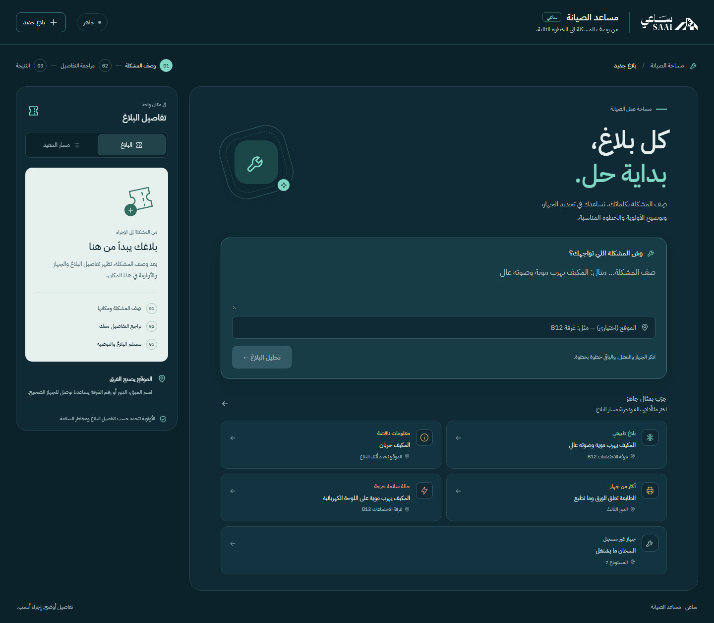
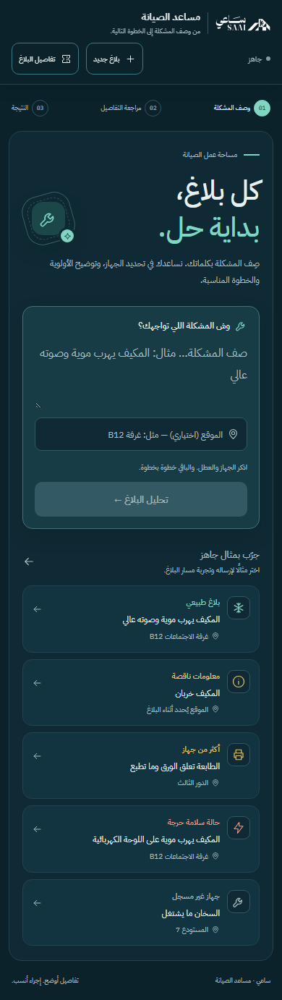

# تحديث واجهة مساعد الصيانة — 2026-10-14

نُفذ التحديث داخل `D:\Disktop\ai-maintenance-assistant\ai-maintenance-assistant` فقط. واجهة الصيانة أصبحت مساحة عمل مستقلة: نموذج واضح، مراحل للبلاغ، وملخص مرتبط بالبيانات الفعلية. حُفظ شعار ساعي الأصلي وألوانه الداكنة والنعناعية والخط العربي؛ الشعار متاح محليًا في `frontend/public/logo-white.svg`، ومصدره الأصلي `https://www.saai.sa/logo-white-cropped.svg`.

- الكمبيوتر: نموذج البلاغ قبل الأمثلة، وموقع اختياري، ولوحة جانبية ثابتة للبلاغ ومسار التنفيذ. الحالة الفارغة توضح طريقة الاستخدام بدل قائمة حقول فارغة.
- الجوال والتابلت: ترويسة مختصرة، بطاقات وأزرار مناسبة للمس، وخيارات أجهزة في عمود واحد على الشاشات الصغيرة. تفاصيل البلاغ تظهر في لوحة سفلية عند الطلب، مع إيقاف تمرير الخلفية.
- الوصول: Escape يغلق اللوحة ويعيد التركيز، وTab يدور داخلها، والأسهم وHome وEnd تبدّل تبويباتها. اختيار الأجهزة ما زال يستخدم radio أصلية. تتوقف الحركة عند طلب تقليلها، وتُستخدم أحجام إدخال 16px على الجوال.
- النتائج: بطاقات منفصلة للنجاح والمخاطر والخطأ، وتحذيرات ظاهرة، ونصوص ملتفة، وإجراءات واضحة. لم تتغير قواعد السلامة أو API أو قاعدة البيانات.

التحقق: نجحت 42 حالة انحدار للواجهة، ثم نجحت الحالات الست الجديدة بعد إصلاح دورة التركيز داخل لوحة الجوال. مجموعة الاختبار الافتراضية تحتوي الآن 48 حالة. التقرير يجمع أحدث نتيجة لكل حالة ويحفظ روابط التقارير الخام في `docs/qa/ui-refresh/verification.json`؛ لا توجد حالات فشل مُتجاهلة. البناء `npm run build` ناجح.

الاختبارات تشمل إرسال الموقع إلى API فعلي بقاعدة مؤقتة، واستكمال اختيار الجهاز، وفتح مسار التنفيذ، وحفظ مسودة الإدخال عند إغلاق اللوحة، وتبديل مقاسات العرض من 320 إلى 1920 دون تمرير أفقي. فحص التباين السابق اجتاز 4.5:1. المتصفح الآلي المستخدم Chromium؛ هذا لا يدّعي اختبار أجهزة Safari فعلية.

حُفظت صور خمس مقاسات، وحالات البداية واختيار الجهاز والنجاح ولوحة التفاصيل في `docs/qa/ui-refresh/`. فحص الصور يستخدم ردود API تجريبية معلنة، ولا ينشئ سجلات صيانة في قاعدة المستخدم.

النسخة السابقة من ملفات الواجهة محفوظة في `backend/data/backups/ui-refresh-20261014-070611/`.
